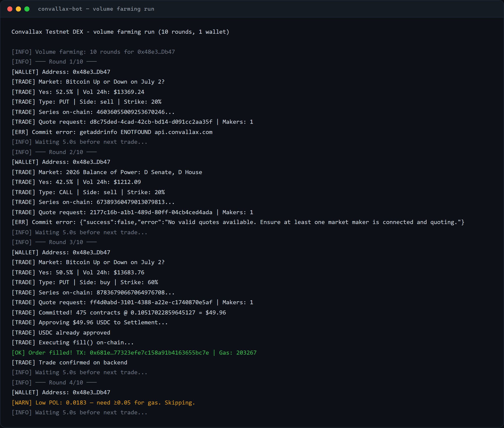

# Convallax Testnet Bot

Options trading automation for [Convallax](https://www.convallax.com/predict) — trade calls and puts on Polymarket prediction market outcomes.

## Bukti run (dari bot sendiri, bukan mockup)



Kartu di atas dirender dari output bot sendiri (`convallax-manual-test-output.txt`): 10 ronde
volume farming, order PUT di pasar "Bitcoin Up or Down", quote request ke backend, dan
`Trade confirmed on backend`. Alamat wallet dipotong (`0x48e3...Db47`).

**Status hari ini (13 Nov 2026), apa adanya:**

- RPC lama `rpc-amoy.polygon.technology` sudah mati (`getaddrinfo ENOTFOUND`) → `config.rpcUrl`
  diganti ke `https://polygon-amoy-bor-rpc.publicnode.com` (chainId 80002, sudah dicek).
- Faucet: wallet 1 dapat HTTP 503 (endpoint sedang ganggu), wallet 2 **sukses 1000 test USDC**
  dengan TX `0xd41caf...01dd`.
- Volume farming hari ini **dilewati**: saldo POL 0.0183 / 0.0337, sedangkan bot minta ≥ 0.05 POL
  untuk gas. Bukan bug — wallet memang belum diisi gas. Isi sedikit POL Amoy lalu jalankan lagi.

## 🌐 Website
https://www.convallax.com/predict

## 🔗 Referral
https://www.convallax.com/predict

## Features
- 🚰 **Auto Faucet** — Claim 1000 test USDC + POL gas per wallet
- 📈 **Options Trading** — Request quotes → commit → fill on-chain
- 🔄 **Volume Farming** — Multi-round trading for Zealy quest completion
- 👛 **Multi-Wallet** — Process unlimited wallets from privateKey.txt
- ⚡ **CLI Menu** — Interactive menu + `--daily` / `--faucet` flags

## Chain
- **Network:** Polygon Amoy Testnet (Chain ID 80002)
- **RPC:** https://rpc-amoy.polygon.technology
- **Explorer:** https://amoy.polygonscan.com

## Contracts
| Contract | Address |
|----------|---------|
| ConvallaxCore | `0xc760F8f6B8830463822be9F68eB10e1b5Dace378` |
| ConvallaxRFQSettlement | `0xC6Eb814Cc01189e20B2DB2D2a22Ed2DcAC404992` |
| ConvallaxOptionToken | `0xd6F69CecCdf846563bE20A860F0A38D3e9324959` |
| USDC (test) | `0xCc544B615B244Cf59A7cB6Cb7d7119ef73A485E5` |

## Setup
```bash
npm install
```

Add your private key(s) to `privateKey.txt` (one per line):
```
0xYOUR_PRIVATE_KEY_HERE
```

## Usage
```bash
# Interactive menu
node index.js

# Auto daily (faucet + farm volume all wallets)
node index.js --daily

# Faucet only
node index.js --faucet
```

### Menu Options
1. **Claim Faucet** — 1000 USDC per wallet
2. **Single Trade** — One trade with first wallet
3. **Farm Volume** — Multiple rounds with first wallet
4. **Farm Volume All** — Multiple rounds all wallets
5. **Check Balance** — USDC + POL for all wallets
6. **Full Daily** — Faucet + farm all wallets

## Trade Flow
1. Fetch active markets from `/v1/markets`
2. Create quote request (off-chain, no gas)
3. Poll for market maker quotes
4. Commit to best quote
5. Approve USDC to Settlement contract
6. Call `fill()` on-chain (atomic: pay premium + mint options)

## Zealy Quests
- 5/25/50/100/500 testnet trades
- $1K/$10K/$20K/$50K/$100K volume
- $2,500 prize pool (top 100 leaderboard)

## Backed by
Alliance DAO

## Contact
@rmndkyl

## 💰 Harga

| Lisensi | Harga | Fitur |
|---------|-------|-------|
| **Single** | Rp 100.000 / ~$6 | 1 device, lifetime |
| **Bundle (3 bot)** | Rp 250.000 / ~$16 | Pilih 3 bot, hemat 20% |
| **Pro (semua bot)** | Rp 1.100.000 / ~$70 | Semua bot + update, hemat 30% |

**Cara beli:** Chat [@OG_LYID_bot](https://t.me/OG_LYID_bot) di Telegram → /buy

**Bayar pakai:**
- 🇮🇩 DANA / GoPay / ShopeePay / BCA / Seabank
- 🌐 Crypto (USDT/SOL/ETH)

## 🔧 Troubleshooting

| Masalah | Solusi |
|---------|--------|
| `Cannot find module` | Jalankan `npm install` di folder bot |
| `insufficient balance` | Pastikan wallet punya cukup token untuk gas |
| `429 Too Many Requests` | Tunggu 30-60 detik, bot auto-retry |
| Proxy error | Cek `proxy.txt` — pastikan proxy aktif |
| Bot diam/tidak jalan | Cek `config.json` — pastikan API key valid |
| License invalid | Chat [@OG_LYID_bot](https://t.me/OG_LYID_bot) → /verify |

**Butuh bantuan?** Join [Discord](https://discord.gg/ZK2NVkfSNn) atau chat [@layerairdrop](https://t.me/layerairdrop)
